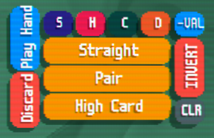

# Quick Hand Selector (Balatro)

Adds a draggable panel to the in-run HUD with buttons that select a hand or a
combination directly. One button per poker hand your hand can currently make, one per
suit, and a set of side actions for inverting the selection, topping it up with your
lowest cards, or clearing it. Every button also works from the keyboard, and
right-clicking any of them runs its opposite.

You still decide what to play — the panel just saves you picking the cards out one by
one. It never reads hand levels, chips, mult or jokers, and it never ranks your
options by score.

> **Note:** I want to make it absolutely clear that this mod was completely
> vibe-coded. By that I mean I didn't write **any** of the code myself — I described
> what I wanted to Claude Opus 5 in plain language, and it wrote, debugged and
> refactored the whole thing. What I did do was direct it and **test it thoroughly**
> in-game. If something in here is broken or could be done better, that's on the
> process, not on any human engineering judgment.

## Features

- A button for every poker hand your hand can currently make, best rank first.
  Pressing the same one again cycles through the alternative combinations — with
  three pairs on the table, "Two Pair" walks through all three pairings.
- Four suit buttons, plus actions to invert the selection, add your lowest cards up
  to the limit, and clear everything.
- Extra buttons that appear only when they are relevant: one for debuffed cards, one
  for face-down cards.
- An optional copy of the game's own Play and Discard buttons, on either side.
- Full keyboard control, rebindable from the game's options menu.
- Localized in all 15 languages Balatro ships with.

## Behaviour

- **Face-down cards are never read.** Blinds like The Fish or The House hide card
  ranks on purpose, so those cards never reach the evaluator and never influence any
  ordering. The mod will not quietly defeat a blind for you.
- **Debuffed cards** score nothing, so they are offered first when discarding and
  last when keeping. Both of those can be switched off.
- Jokers that change what is *possible* — Four Fingers, Shortcut, Wild Cards,
  Smeared Joker — are respected, because the game's own evaluator does the work.

## Requirements

- **Balatro** (PC).
- **[Lovely](https://github.com/ethangreen-dev/lovely-injector)** — this is a
  Lovely-only mod. **Steamodded is not required**, and it works fine alongside it.
- No other mod dependencies.

## Installation (manual)

1. Install [Lovely](https://github.com/ethangreen-dev/lovely-injector) if you haven't
   already, following its own instructions for your OS.
2. Download this repository (**Code → Download ZIP**, or a tagged release ZIP) and
   unzip it.
3. Copy the extracted folder into your Balatro `Mods` directory, so that
   `.../Mods/<this-mod-folder>/lovely/modules.toml` exists. The folder name itself
   doesn't matter, only its contents.
   - **Windows:** `%AppData%\Balatro\Mods\`
   - **macOS:** `~/Library/Application Support/Balatro/Mods/`
   - **Linux (native / Proton):** `~/.local/share/Balatro/Mods/`, or the equivalent
     path under your Proton prefix's
     `pfx/drive_c/users/steamuser/AppData/Roaming/Balatro/Mods/`
4. Launch the game through Lovely as usual. The panel appears the next time you start
   a blind.

## Options

The game's **Options** menu gets a "Quick Hand Selector" entry at the bottom, with two
tabs:

- **Keybinds** — every action is rebindable, plus a button to restore the defaults.
  Defaults are `1`–`9` for the hand list, `Q W E R` for the suits, `T` to add lowest,
  `F` to invert, `X` to clear, `A` and `D` for the bottom row, and **Space** held down
  as the inverse modifier.
- **Options** — checkboxes for suit ordering, debuffed priority, ignoring face-down
  cards, locking the panel in place, and showing the Play/Discard column on either
  side.

## Panel

- **Left-click** a button to run it; **right-click** to run its opposite. A suit
  button picks that suit; right-clicking picks everything that isn't that suit. A hand
  button selects that hand; right-clicking selects everything else.
- **Hold the inverse key** (Space by default) to do the same from the keyboard.
- **Drag** the panel anywhere; the position is saved and constrained so it can never
  end up somewhere the cursor can't reach.
- When every card in hand is face down, the list is replaced by a single inert `? ? ?`
  button — there is nothing legitimate to offer, and guessing would give away exactly
  what the blind is hiding.

## License

GPLv3. `src/draggable_container.lua` derives from MoveableContainer in BalaLib by
Toeler, via Ankh (MathIsFun0) and SystemClock (Breezebuilder), which is licensed
GPLv3 — this mod inherits that license as a result. See [LICENSE.md](LICENSE.md) for
the full text.

English and Spanish were written and checked directly; the other translations were
produced without native review. If you speak one of them and something reads wrong,
please open an issue or a pull request.
